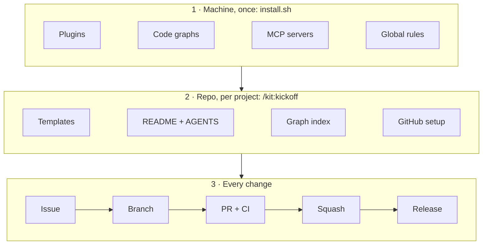

<div align="center">

# my-starter-kit

**Everything in its place before you code.**

My Claude Code setup in one repo: one script installs the agent tooling on a machine,
and one command turns an idea into a repository that is ready for agent-driven work.

[](https://code.claude.com/docs)
[](LICENSE)


[Why](#why) · [What's inside](#whats-inside) · [Built with it](#built-with-this-kit) · [Install](#install) · [Kickoff](#kitkickoff) · [Code intel](#kitcode-intel) · [Fork it](#fork-and-customize)

</div>

## Why

I kept starting repos and repeating the same things to my agents: the folder structure, a README
that sells, tests and evals, the About description, and above all the **issue → branch → PR**
flow with CI. This kit writes all of that down once.

It is opinionated and personal. It is public so you can fork it and swap in your own choices.

## How it fits together



<sub>Plugins: workflow skills, Ponytail, Floorplan, kit · Code graphs: GitNexus, Graphify · MCP: Context7, Playwright · CI on every PR: tests, `ci-pass`, PR-title lint, secret scan.</sub>

## What's inside

| Tool | What it does here | Level |
|---|---|---|
| **kit** (this plugin) | `/kit:kickoff` and `/kit:code-intel` | Global |
| [agent-skills](https://github.com/addyosmani/agent-skills) *or* [ECC](https://github.com/affaan-m/ECC) | Engineering workflow skills (spec → plan → test → review → ship). Pick one with `--workflow` | Global |
| [Ponytail](https://github.com/DietrichGebert/ponytail) | Makes the agent write the least code that does the job | Global |
| [Floorplan](https://github.com/haydenschmitty/floorplan) | Human-readable map of an app's architecture, on demand | Global |
| [GitNexus](https://www.npmjs.com/package/gitnexus) | Code graph + impact analysis before changes (MCP, hooks) | Global + per repo |
| [Graphify](https://github.com/safishamsi/graphify) | Graph of code **and** docs, PDFs, images | Global + per repo |
| [Context7](https://github.com/upstash/context7) | Up-to-date library docs in context (MCP) | Global |
| [Playwright MCP](https://github.com/microsoft/playwright-mcp) | Lets the agent drive a real browser to check the UI | Global |
| [ccusage](https://github.com/ryoppippi/ccusage) | Measures token usage, to check what the rest actually saves | Global |
| [promptfoo](https://github.com/promptfoo/promptfoo) | LLM evals, wired into every template | Global + per repo |
| [pre-commit](https://pre-commit.com) | Lint, format and secret checks before each commit | Global + per repo |
| [Langfuse](https://github.com/langfuse/langfuse) | LLM tracing in the templates; self-host with `--with-langfuse` | Per repo |
| [release-please](https://github.com/googleapis/release-please) | Changelog, version and release from Conventional Commits | Per repo |
| [OmniRoute](https://github.com/diegosouzapw/OmniRoute) | Local LLM gateway, opt-in with `--with-omniroute` | Optional |

**Templates** (copied by `/kit:kickoff`):

- `common` — `AGENTS.md` (+ `CLAUDE.md` → `@AGENTS.md`), `DECISIONS.md` (ADRs), issue forms
  (bug, feature, task), PR template, `type:*` / `priority:*` / `area:*` labels, CODEOWNERS,
  Dependabot, SHA-pinned workflows (PR-title lint, release-please, gitleaks, label sync),
  `.claude/settings.json` (agents can't push `main`, force-push or merge), pre-commit with a
  commit-msg hook, CONTRIBUTING, SECURITY, LICENSE.
- `python` — uv, FastAPI, pydantic-settings, LiteLLM + Langfuse LLM layer, Ruff, mypy strict,
  pytest with coverage, promptfoo evals, Dockerfile, CI.
- `typescript` — Next.js (App Router) overlay: Tailwind + shadcn/ui, Biome, Zod env validation,
  Vercel AI SDK (Anthropic + OpenAI) + Langfuse, Vitest, Playwright, promptfoo evals, CI with e2e.
- `rust` — edition 2024 CLI + library (clap, anyhow, thiserror, tracing), clippy pedantic
  with `-D warnings`, rustfmt, cargo-deny (licences, advisories), integration test, CI.
- Python and TypeScript together as a monorepo (`apps/api` + `apps/web`).

## Built with this kit

Four of my own repos follow the same templates, CI and issue → PR flow:

| Repo | What it is | Stack | Specific to it |
|---|---|---|---|
| [rag-hive](https://github.com/enzo-thuilliez/rag-hive) | Multi-agent swarm that benchmarks RAG pipelines on your PDFs | Python · React | Releases off until the project works |
| [pillbox](https://github.com/enzo-thuilliez/pillbox) | AI-assisted staff scheduling for pharmacies | TypeScript · Python | CI check that fails on any real name (denylist kept in a secret) |
| [orderup](https://github.com/enzo-thuilliez/orderup) | Claude Code sessions as cooks in a 3D kitchen, `npx orderup-cli` | TypeScript · three.js | Keeps its own Changesets and npm release |
| [etf-replication-engine](https://github.com/enzo-thuilliez/etf-replication-engine) | Rust optimizer for index replication, driven by an LLM agent over MCP | Rust · Python · React | Cargo workspace with shared clippy lints and cargo-deny |

Each has the same `AGENTS.md` shape, `ci-pass` / PR-title / secret-scan checks, labels as code
and a protected `main`, so an agent dropped into any of them already knows the rules.

## Install

Requirements: Linux or WSL (Ubuntu), Node 22+, [Claude Code](https://code.claude.com/docs),
[GitHub CLI](https://cli.github.com). The script installs the rest (uv, build tools) and asks
for `sudo` only for apt packages.

```bash
git clone https://github.com/enzo-thuilliez/my-starter-kit.git
cd my-starter-kit
./install.sh --dry-run     # see what it would do
./install.sh               # do it
```

Options:

| Flag | Effect |
|---|---|
| `--workflow=agent-skills` | Default workflow layer. Uninstalls ECC if present |
| `--workflow=ecc` | ECC instead, with `ECC_HOOK_PROFILE=minimal`. Uninstalls agent-skills |
| `--with-omniroute` | Install the OmniRoute gateway (Node 22 or 24) |
| `--with-langfuse` | Run a self-hosted Langfuse with Docker on `localhost:3000` |
| `--windows-too` | Print the PowerShell steps for Claude Code on the Windows side |
| `--dry-run` | Print every command, change nothing |

The script is **idempotent**: run it again any time to update everything. Your global rules
go into a delimited block of `~/.claude/CLAUDE.md`; anything else in that file is left alone,
and a `.bak` is kept on every change.

Only want the skills? `claude plugin marketplace add enzo-thuilliez/my-starter-kit && claude plugin install kit@my-starter-kit`.

## `/kit:kickoff`

Run it in an empty folder, an empty GitHub repo, or a repo that already has code.

1. **Detects** where you start. Existing code is never overwritten (retrofit mode).
2. **Asks one sentence**, then **two rounds of pre-filled questions** (name, features, stack,
   LLM, deploy, visibility, evals, admin bypass) and shows the **spec**; nothing is created
   before you say `go`.
3. Opens a **"Bootstrap repository"** issue and a `chore/<n>-bootstrap` branch.
4. **Applies the templates** and scaffolds the stack.
5. Writes **AGENTS.md** for the project and a **selling README**.
6. Gets lint, types and tests **green**, installs pre-commit, runs `/kit:code-intel`.
7. Opens the **bootstrap PR** — you review and merge it.
8. Sets the **About and topics**, squash-only merges, branch auto-delete, labels, and
   **branch protection** on `main` (skipped for private repos on a free plan, which GitHub doesn't allow) (`ci-pass`, PR title and secret scan required).
9. Creates a **v0.1 milestone** with one issue per feature.
10. Leaves **releases off**: a "first release" issue explains how to turn them on
    (`gh variable set RELEASES_ENABLED --body true`) once the project actually works.

A Python project ends up like this:

```
my-project/
├── .github/
│   ├── ISSUE_TEMPLATE/        bug · feature · task
│   ├── workflows/             ci · evals · pr-title · release-please · secrets · labels
│   ├── CODEOWNERS  dependabot.yml  labels.yml  pull_request_template.md
├── src/app/                   main.py · config.py · llm.py
├── tests/                     test_api.py · test_llm.py
├── evals/                     promptfooconfig.yaml · provider.py
├── AGENTS.md  CLAUDE.md  README.md  CONTRIBUTING.md  SECURITY.md  LICENSE
├── Dockerfile  pyproject.toml  .pre-commit-config.yaml  .env.example
└── release-please-config.json
```

## `/kit:code-intel`

GitNexus and Graphify overlap, so each repo gets **one** primary graph tool. The skill measures
the repo: mostly code → **GitNexus** (call chains, impact before a refactor); docs, PDFs or
notes that matter as much as code → **Graphify**. It tells you why, indexes, and writes the
"Code intelligence" section of `AGENTS.md`. You can always overrule it.

## Global rules

`global/CLAUDE.md` is what I used to repeat in every session:

- English everywhere.
- Never push to `main`; issue → `type/<n>-desc` branch → PR with `Closes #n`; Conventional Commits; squash.
- The agent opens the PR and stops. Merging is mine.
- Tests with every change, checks green before a PR, never skip a test.
- Impact analysis before refactors, Context7 for library docs.
- Selling README, About in sync, no secrets in git.

## Fork and customize

1. Fork, then replace `enzo-thuilliez/my-starter-kit` in `install.sh` (`REPO=`) and in
   `.claude-plugin/marketplace.json`.
2. Edit `global/CLAUDE.md` — it is your rulebook.
3. Change the tool list in `install.sh` (each step is a small function).
4. Add a stack: create `templates/<stack>/` with its files and a `_kit.md` (scaffold commands,
   AGENTS.md command table, monorepo notes). `/kit:kickoff` reads it.
5. Template rules (see `scripts/apply-template.sh --help`): stack files overwrite `common` ones,
   `*.append` files are appended, `_kit.md` is never copied, only `{{UPPER_CASE}}` variables you
   pass are replaced.

## Contributing

Issues and PRs welcome. The kit follows its own rules: see [AGENTS.md](AGENTS.md).
Before a PR: `claude plugin validate .` and `shellcheck install.sh scripts/*.sh`.

## License

[MIT](LICENSE) © 2026 Enzo Thuilliez. Each tool listed above keeps its own license.
